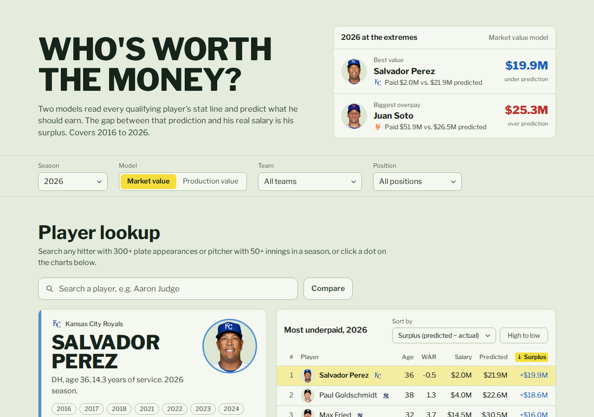

# MLB Player Value

What MLB players *should* earn based on their production, next to what they're actually paid, for 2016 through 2026 (2020 left out).

**Live site: <https://nickolastran.github.io/mlb-player-value>**

[](https://nickolastran.github.io/mlb-player-value)


## What's in the folder

| Path | What it is |
|---|---|
| `src/` | The site: React + TypeScript (`.tsx`), styled with Tailwind, animated with Motion, charts with Plotly |
| `player-seasons.csv` | Source data: one row per qualifying player-season, with stats, salary and service time |
| `public/data/<season>-<model>.json` | One file per season and model, read by the site |
| `public/data/seasons.json` | Seasons, models (with test R²), tax thresholds and teams |
| `public/data/mlbam.json` | Baseball-Reference ID → MLB ID, used for player headshots |
| `docs/screenshot.png` | The screenshot at the top of this README |
| `scripts/scrape.py` | Downloads stats and salaries from Baseball-Reference into `player-seasons.csv` |
| `scripts/build_data.py` | Trains the models and writes everything in `public/data/` |
| `scripts/player_ids.py` | Maps players to MLB IDs via the Chadwick Bureau register, for headshots |

## Updating the data

You need Python 3.9+ with `pip install pandas scikit-learn shap requests`.

```bash
python scripts/scrape.py       # slow the first time: ~2,000 player pages at 4 s each
python scripts/build_data.py   # about a minute
python scripts/player_ids.py   # seconds; only needed when new players appear
```

`scrape.py` caches every page in `.cache/`, so reruns only fetch what's missing. It waits 4 seconds between requests because Baseball-Reference blocks clients that go over about 20 a minute. To refresh a page (say, a season still in progress), delete its file from `.cache/`.

### Adding a season

1. Add it to `SEASONS` in `scripts/scrape.py` and its tax threshold to `CBT` in `scripts/build_data.py`.
2. Run the three scripts, commit `player-seasons.csv` and `public/data/`, push, then `npm run deploy`.

The newest season is always held out of training, so it's shown as fully out-of-sample.

## Running it locally

You need Node 20+.

```bash
npm install
npm run dev   # then open http://localhost:5173
```

## Deploying

The site is on GitHub Pages at <https://nickolastran.github.io/mlb-player-value>.

```bash
npm run deploy
```

This builds with the `/mlb-player-value/` base path, copies `index.html` to `404.html` so `/players` loads the app instead of a 404, and pushes `dist/` to the `gh-pages` branch, which Pages serves (Settings → Pages → Deploy from branch `gh-pages`). The CSV and scripts stay out of the deployment.

Player headshots and team logos load from MLB's image servers (`img.mlbstatic.com`, `www.mlbstatic.com`) and belong to MLB; fine for a non-commercial project, but check MLB's terms before using them commercially.

## Methodology in brief

- **Market value model.** Random forests (one for hitters, one for pitchers) on season stats, WAR, hitter position (as the standard positional adjustment: C highest, DH lowest), hitter defensive WAR (Baseball-Reference's dWAR, the player's own defense plus position), age, service time and track record (last season's WAR and the last five seasons' total, from the league pages, so seasons that didn't qualify still count). Predicts salary as a share of the season's competitive balance tax threshold.
- **Production value model.** The same without age, service time and track record. The gap between the two is the *service-time discount*: what pre-arbitration and arbitration rules save teams.
- **Who's included.** Hitters with 300+ PA, pitchers with 50+ IP. Two-way players count as hitters with both WARs added.
- **Salaries.** From Baseball-Reference player pages. Pre-arbitration years it skips are estimated at the league minimum (shown as ≈, never trained on) for drafted players under 3 years of service; `python scripts/test_fill_gap.py` checks that rule. A salary listed under a team the player didn't play for (usually an option buyout) is dropped.
- **Why this prediction.** SHAP values (TreeExplainer) split each prediction into what every stat added or took off, starting from the average hitter or pitcher.
- **80% range.** The 10th–90th percentile of the 400 trees' guesses, stretched per model and role so 80% of test-set salaries fall inside (the raw spread covers about half), floored at the season's lowest salary.
- **Residual.** `(actual − predicted) / CBT threshold`. Positive means overpaid relative to the model.
- **Train/test.** 80/20 random split of 2016–2025; 2026 is never trained on.
- **Next contract.** For upcoming free agents, the prediction times one year of aging. The aging factor is a straight line fit to how production value changes between a player's back-to-back seasons at each age (about +5% at 27, −3% at 32, −9% at 36), in the newest season's dollars.

## Limitations

- **Salary is what Baseball-Reference lists for the year, not the contract's value.** A front- or back-loaded deal looks underpaid in its cheap years and overpaid in its expensive ones, even though the average annual value (AAV) never changes. The model has no idea how long a contract is or how much is guaranteed.
- **Deferred money and bonuses.** The listed figure doesn't always include signing bonuses or deferrals, so some contracts look cheaper than they are (Nick Pivetta's 2025, for one). Shohei Ohtani's 2024–2026 salary is listed as $28.2M a year. That's neither the $2M actually paid each year nor the $70M AAV before deferrals, so his surplus depends on which figure you'd pick.
- **Injured seasons drop out.** A player-season only exists if it clears 300 PA or 50 IP, so a big contract spent mostly on the injured list never shows up as an overpay. The overpaid end of each season is incomplete, and team surplus leaves out money paid to injured players. Those seasons do still count toward the next season's `WAR_prev5`.
- **The 80% range is calibrated on the test set.** Each model and role gets one stretch factor, chosen so exactly 80% of the 2016–2025 test salaries land inside. On those rows it covers 80–81% by construction. On 2026, which no model saw, it covers 70–78%, so read it as roughly 75%. The stretch is the same for everyone, so the range is too wide for some players and too narrow for others. A quantile regression forest would fit each player better.
- **Past seasons are mostly in-sample.** The 2016–2025 seasons in the training set have residuals that look better than the models would manage on new data. Only `test` rows and 2026 are fair measures of error.
- **The aging line is optimistic for older players.** It only learns from players who qualify in both seasons, so the ones who decline out of the data don't pull it down. It's also one year of aging applied to a multi-year deal, so read `next` as a first-year value rather than the average over the contract.
- **Contract status is a snapshot.** `fa` and `fa_option` come from each player's page when it was scraped, and only describe the newest season.

## Data dictionary

`public/data/<season>-<model>.json` is an array of player-seasons, sorted by predicted salary. Dollar amounts are whole dollars. `_pct` fields are a share of that season's CBT threshold (`0.1` = 10% of it), which puts different seasons on one scale. `null` means not available, usually because Baseball-Reference lists no salary.

| Field | Meaning |
|---|---|
| `id` | Baseball-Reference player ID (`wheelza01`); `mlbam.json` maps it to an MLB ID |
| `player`, `team` | Name and team code; for a traded player, the last team they played for |
| `traded` | Played for more than one team that season; stats are the combined line |
| `pos`, `role` | Primary position; `role` is `H` (hitter) or `P` (pitcher), and each role has its own model |
| `age`, `service` | Age that season; MLB service time in years (172 days = 1 year) |
| `g`, `war` | Games, Baseball-Reference WAR |
| `pa` `hr` `sb` `avg` `obp` `slg` `ops_plus` | Hitters only: season batting stats |
| `ip` `gs` `sv` `era` `era_plus` `so` `whip` | Pitchers only: season pitching stats |
| `salary`, `salary_pct` | Actual salary that season |
| `salary_est` | `true` if `salary` is an estimate (the league minimum for a pre-arb year Baseball-Reference skips), not a listed figure; never trained on |
| `pred`, `pred_pct` | The model's predicted salary |
| `pred_lo`, `pred_hi` | 80% range around `pred`, rounded outward to $10K and never below the season's lowest salary |
| `pred_rank` | Rank by `pred` that season, 1 = highest |
| `surplus`, `surplus_pct` | `pred − salary`; positive means underpaid relative to the model |
| `surplus_rank` | Rank by `surplus` that season, 1 = most underpaid |
| `residual_pct` | `(salary − pred) / CBT`, the same gap as `surplus_pct` with the opposite sign; positive means overpaid |
| `split` | `train` or `test` (the 80/20 split of 2016–2025), `projection` for the newest season (never trained on), `null` for a past season whose salary is missing or estimated |
| `why` | `[[feature, dollars], …]`, biggest effect first: SHAP values, what each feature added to or took off the prediction. `pred` minus their sum is the average for the role. Feature names are columns in `player-seasons.csv`, except `Pos_adj`, the positional adjustment `build_data.py` derives from `Pos` |
| `comps` | Market files only: `[[id, season], …]`, the 5 most similar seasons by other players in other seasons with a listed salary (same stats plus age, standardized) |
| `fa` | Newest season only: the first season the player is a free agent, from their contract status at scrape time |
| `fa_option` | Newest season only: `team`, `player` or `mutual` if an option covers the `fa` season, else `null` |
| `next` | Newest season only, with `fa`: estimated yearly value of the next contract, `pred` aged one year and rounded to $10K |

`seasons.json` lists every season (`cap` is its CBT threshold, `players` its row count, `splits` the splits present), both models with their test `r2`, all team codes, `generated`, the date the data was built, and `as_of`, the date the newest season's stats were downloaded (shown in the site footer).

The **Download CSV** button on the site exports the rows on screen with the same values: `Salary`, `Predicted`, `Predicted low/high (80%)` and `Surplus` are `salary`, `pred`, `pred_lo`/`pred_hi` and `surplus`.
